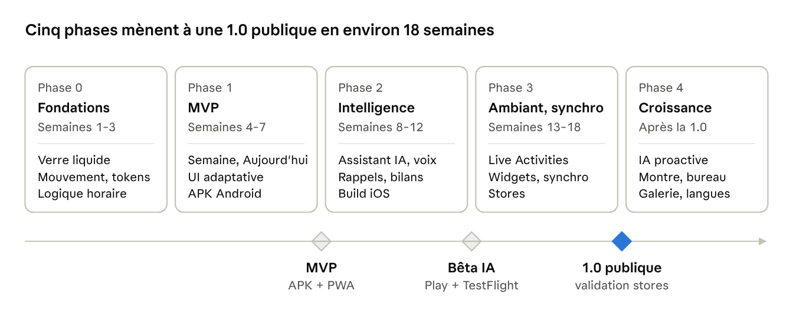
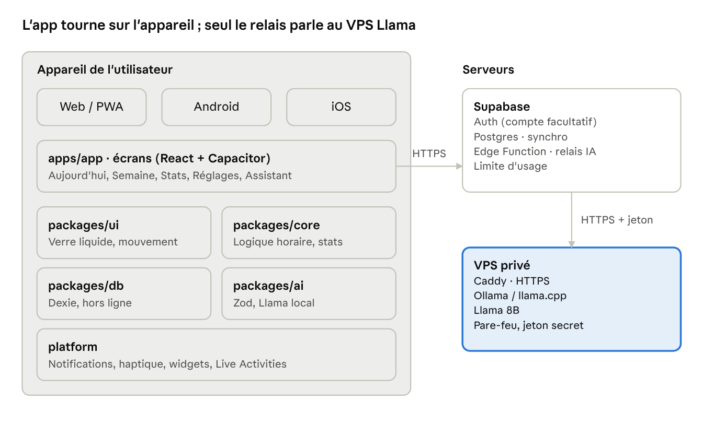

# Kairo : Cahier des charges & Feuille de route

Nov 22, 2026 · @René

Kairo est un planificateur de semaine IA-native, pour tout le monde (étudiants, salariés, sportifs, soignants en horaires décalés, freelances). Il est livré à partir d'une seule base de code en application web, APK Android et application iOS, avec une interface de nouvelle génération : matériaux en verre liquide, interface qui s'adapte au contexte, assistant intelligent au cœur de l'expérience.

## Feuille de route en un coup d'œil



Chaque jalon ne s'ouvre que lorsque les critères d'acceptation de sa phase sont validés : un MVP fonctionnel, puis une bêta avec l'assistant IA, puis l'approbation sur Google Play et l'App Store.

## Vision produit

Kairo transforme une routine en une semaine claire et coloriée, puis aide l'utilisateur à la suivre grâce à une interface qui comprend son contexte : ce qu'il fait maintenant, ce qui arrive ensuite, et ce qu'il faut ajuster. Nom retenu : « Kairo », de kairos, « le moment juste » en grec. Reste à vérifier la marque déposée, la disponibilité sur les stores et le nom de domaine.

**Problème.** Les agendas sont faits pour des réunions, pas pour des routines. Ceux qui planifient leur semaine (études, sport, gardes, projets perso) finissent avec un tableur ou un PDF imprimé qui ne rappelle rien, ne mesure rien et ne s'adapte jamais.

**Utilisateurs cibles**

| Profil | Semaine type | Besoin principal |
| --- | --- | --- |
| Étudiant | Cours, révisions, formations en ligne, sport | Heures par matière, sessions tardives, semaines d'examens |
| Salarié de bureau | Horaires fixes, salle de sport, projet perso, famille | Équilibre vie pro / perso, rappels |
| Soignant / travail posté | Gardes de jour et de nuit en rotation | Rotations (2-2-3, 4 jours / 4 jours), blocs après minuit |
| Sportif / coach | Entraînements, récupération, matchs, sommeil | Charge par catégorie, suivi du sommeil |
| Freelance | Blocs clients, administratif, formation | Heures par client, bilan hebdomadaire |
| Routines et habitudes | Prière, lecture, rituels | Blocs courts récurrents, rappels discrets |

**Principes produit**

1. **La semaine est l'unité.** L'écran principal montre la semaine d'un coup d'œil, comme le tableau A3.
2. **IA-native, pas IA ajoutée.** L'intelligence fait partie de chaque écran (créer, ajuster, résumer), pas un chatbot dans un coin.
3. **La couleur porte le sens.** Chaque bloc appartient à une catégorie, avec une seule couleur utilisée partout.
4. **Hors ligne d'abord, privé par défaut.** L'app fonctionne sans compte ni internet ; l'IA et la synchronisation sont activées par l'utilisateur.
5. **Les journées peuvent dépasser minuit.** Un bloc de 23:00 à 03:00 appartient au jour où il commence.
6. **Une seule base de code.** Web, Android et iOS partagent la même interface et la même logique.

## Direction de design : interface IA-native

**Exigence n°1 : pas de design classique.** L'interface suit la nouvelle génération de design que l'on voit aujourd'hui sur les grands systèmes : des matériaux en verre liquide translucide (dans l'esprit de Liquid Glass d'Apple, introduit avec iOS 26), une expressivité et un mouvement physique (dans l'esprit de Material 3 Expressive de Google), et surtout une interface pilotée par l'IA, qui se reconfigure selon le contexte au lieu d'être une suite d'écrans figés. On garde l'ADN du tableau A3 : fond nuit profond, couleurs de catégories vives, chiffres en police monospace.

**Les cinq piliers**

| Pilier | Ce que cela veut dire concrètement | À éviter |
| --- | --- | --- |
| **1. Matériaux en verre liquide** | Barres, cartes et panneaux en verre translucide qui floute, réfracte et reflète les couleurs des blocs dessous ; reflets spéculaires qui suivent le gyroscope ou le pointeur ; les contrôles flottent au-dessus du contenu. | Cartes plates opaques, ombres portées lourdes, bordures grises |
| **2. Interface adaptative et générative** | L'écran se recompose selon le moment : le matin la vue Aujourd'hui passe devant, pendant un bloc le compte à rebours prend toute la place, le dimanche soir le bilan apparaît. L'IA peut générer des cartes à la volée (résumé, conseil, comparaison). | Menus profonds identiques pour tout le monde, à toute heure |
| **3. Assistant au cœur, en langage naturel** | Une barre de commande flottante (texte ou voix) : « Déplace mon sport à 18 h samedi », « Construis-moi une semaine d'examens », « Combien d'heures de labo cette semaine ? ». Chaque proposition de l'IA s'affiche en aperçu fantôme sur la grille avant validation. | Un chatbot isolé dans un onglet séparé |
| **4. Mouvement vivant** | Animations à ressort (spring physics), éléments qui se transforment les uns dans les autres (le bloc devient la fiche détaillée), lueur qui « respire » sur le bloc en cours, retours haptiques sur mobile. | Transitions linéaires, changements d'écran secs |
| **5. Présence ambiante** | L'app vit hors de l'app : Live Activities / île dynamique sur iOS, notifications en cours sur Android, widgets en verre sur l'écran d'accueil, montre connectée plus tard. | Une app qu'il faut ouvrir pour savoir quoi faire |

**L'intelligence dans chaque écran**

- **Création :** l'utilisateur décrit sa vie en une phrase, l'IA génère la semaine complète, l'utilisateur ajuste.
- **Adaptation :** si un bloc est manqué, l'IA propose de le replacer dans un créneau libre, sans culpabiliser.
- **Protection :** l'IA signale une semaine surchargée ou un sommeil trop court, et propose une version plus réaliste.
- **Compréhension :** chaque dimanche, un bilan rédigé en langage clair (« Tu as fait 11 h de labo, 2 h de plus que prévu ») avec un graphique généré.
- **Contrôle :** l'IA ne modifie jamais le planning sans validation ; chaque action est annulable.

**Sobriété malgré l'effet « waouh ».** Le verre et le mouvement servent la lisibilité, jamais l'inverse. Le texte reste toujours lisible sur le verre (voile de contraste automatique), et les réglages système « Réduire la transparence » et « Réduire les animations » basculent vers des surfaces pleines et des fondus simples.

## Système de design

Tous les tokens vivent dans un seul fichier (`tokens.ts`) qui alimente Tailwind, pour un rendu identique sur toutes les plateformes. Thème sombre par défaut ; un thème clair existe pour la journée et l'impression.

**Fond et couleurs de base**

| Token | Valeur | Usage |
| --- | --- | --- |
| `bg.base` | #0A0F1C | Fond de l'application |
| `bg.aurora` | dégradés animés lents #12305A, #2A1450, #0E3B2E | Halo « aurore » derrière le verre ; teinte dérivée de la catégorie du bloc en cours |
| `text.primary` / `body` / `muted` / `faint` | #FFFFFF / #E2E8F0 / #94A3B8 / #64748B | Titres, texte, libellés, graduations |
| `accent` | #22C55E | Marque, focus, éléments IA validés |
| `ai` | dégradé #22C55E → #38BDF8 → #8B5CF6 | Réservé à ce que l'IA propose : contour lumineux des aperçus fantômes, barre de commande active |

**Matériaux en verre (3 niveaux)**

| Matériau | Recette web | Usage |
| --- | --- | --- |
| `glass.thin` | fond rgba(255,255,255,0.06), `backdrop-filter: blur(16px) saturate(160%)`, bord 1 px rgba(255,255,255,0.14) | En-têtes de jours, puces, légende |
| `glass.regular` | fond rgba(255,255,255,0.09), blur 24 px, saturate 180 %, reflet spéculaire en dégradé sur le bord haut | Cartes, panneaux, barre d'onglets |
| `glass.thick` | fond rgba(10,15,28,0.55), blur 40 px, légère réfraction (filtre SVG de déplacement sur Chromium, repli sur flou simple ailleurs) | Barre de commande IA, feuilles modales, fiche de bloc |

Repli automatique : sur appareil peu puissant ou avec « Réduire la transparence », chaque matériau devient une surface pleine (#151C2E, #1B2438, #0F1626).

**Palette des catégories** (renommable, recolorable ; chaque couleur a son texte contrasté)

| Couleur | Hex | Texte | Nom par défaut |
| --- | --- | --- | --- |
| Ardoise | #64748B | #FFFFFF | Travail / École |
| Violet | #8B5CF6 | #FFFFFF | Étude / Révision |
| Rose | #EC4899 | #FFFFFF | Formation |
| Vert | #22C55E | #06210F | Pratique |
| Ambre | #F59E0B | #2A1700 | Projet / Labo |
| Rouge | #EF4444 | #FFFFFF | Vidéo / Média |
| Sarcelle | #14B8A6 | #032421 | Bilan |
| Ciel | #38BDF8 | #04202E | Sport (lueur mise en avant) |
| Acier | #3B4456 | #CBD5E1 | Repas / Temps libre |
| Graphite | #273042 | #94A3B8 | Routine / Pauses |
| Nuit | #111827 + rayures diagonales | #64748B | Sommeil |

Les blocs gardent des couleurs pleines (lisibilité), avec un fin reflet de verre sur le bord haut ; le bloc en cours reçoit une lueur qui respire.

**Typographie**

- Titres : Inter Display 800, interlettrage −2 %, un mot du titre en `accent`.
- Texte : Inter 400/600, échelle 12 / 14 / 16 / 20 / 28 / 40 px, compatible taille de police système.
- Heures et chiffres : JetBrains Mono, au format « 07:30–08:30 ».
- Surtitre : monospace, majuscules, couleur `accent`, préfixe « // ».

**Forme et mouvement**

- Grille de 4 px. Rayons : blocs 8 px, cartes 20 px, barre de commande et onglets en forme de capsule.
- Ressorts : `stiffness 380, damping 32` pour les interactions, `stiffness 180, damping 24` pour les transitions d'écran. Transitions à élément partagé entre la grille et la fiche d'un bloc.
- Haptique légère à la validation, au glisser et au début d'un bloc.

**Composants clés** (paquet `packages/ui`)

| Composant | Description |
| --- | --- |
| `GlassSurface` | Primitive de verre (thin / regular / thick) avec reflet, réfraction et repli automatique |
| `TimeBlock` | Bloc coloré : horaire, titre, note ; variantes compacte, sommeil rayé, en cours (lueur), fantôme IA (contour dégradé `ai`) |
| `DayColumn` / `WeekGrid` | En-tête de jour en verre + piste de blocs ; grille 7 jours avec axe horaire adaptatif |
| `CommandBar` | Barre flottante en verre épais, saisie texte et voix, suggestions contextuelles |
| `NowCard` | Bloc en cours, compte à rebours, progression, « À suivre » ; se transforme en Live Activity |
| `InsightCard` | Carte générée par l'IA : texte, mini-graphique, actions « Appliquer / Ignorer » |
| `StatTile`, `HoursBar`, `TopicCard`, `Legend` | Repris du tableau A3, en verre |
| `Sheet`, `Toast` (avec Annuler), `Pill`, `Button` | Primitives standards dans le même style |

## Fonctionnalités et écrans

Cinq espaces principaux et une barre de commande IA accessible partout. Le MVP livre l'accueil, Aujourd'hui, Semaine, l'éditeur de bloc et les réglages ; l'assistant arrive en phase 2.

**Navigation.** Barre d'onglets flottante en verre (capsule) sur téléphone ; barre latérale en verre sur tablette et ordinateur (≥ 1024 px). Onglets : Aujourd'hui · Semaine · Stats · Plannings · Réglages. La `CommandBar` flotte au-dessus, sur tous les écrans.

| Écran / fonction | Ce que l'utilisateur voit et fait | Phase |
| --- | --- | --- |
| **Accueil (onboarding)** | Choix d'un modèle (Étudiant, Salarié, Travail posté, Sportif, Freelance, Vide), heures de lever / coucher et de travail, aperçu animé de la semaine générée. Sans compte. En phase 2 : « Décris ta semaine en une phrase ». | 1 |
| **Aujourd'hui** | `NowCard` plein écran pendant un bloc, compte à rebours, « À suivre », fil de la journée avec cases à cocher, thème du jour. Les blocs après minuit restent sous le jour de départ. | 1 |
| **Semaine** | Le tableau A3 en version vivante : grille, légende, tuiles de stats. Téléphone : un jour par écran avec balayage + bande compacte des 7 jours. Appui long pour glisser un bloc (phase 2). | 1 |
| **Fiche de bloc** (feuille en verre) | Titre, catégorie, début / fin (peut passer minuit), note, jours de répétition, rappel et délai, « compte dans les objectifs ». S'ouvre par transition depuis le bloc. | 1 |
| **Catégories** | Créer, renommer, recolorer, réordonner, archiver ; choisir ce qui compte comme temps de concentration. | 1 |
| **Réglages** | Thème, langue, début de semaine, 12 / 24 h, première heure de la grille, transparence, IA activée ou non, sauvegarde / restauration. | 1 |
| **Assistant IA (CommandBar)** | Commandes en langage naturel, texte ou voix ; propositions affichées en blocs fantômes, à valider ou ignorer ; questions sur ses stats. | 2 |
| **Replanification intelligente** | Bloc manqué → proposition de créneau libre ; alerte semaine surchargée ou sommeil < 7 h. | 2 |
| **Rappels** | Notification au début du bloc et N minutes avant ; heures calmes ; par catégorie. | 2 |
| **Stats et bilan** | Heures par catégorie vs prévu, taux de réalisation, série, sommeil moyen ; bilan du dimanche rédigé par l'IA avec graphique. | 2 |
| **Plannings multiples** | « Semestre », « Vacances », « Mois d'examens » ; un seul actif ; dupliquer, archiver ; thèmes de jour. | 2 |
| **Export et partage** | Affiche A3 en PDF (le design actuel), PNG pour les réseaux, fichier `.ics`, sauvegarde JSON. | 2 |
| **Présence ambiante** | Live Activity / île dynamique (iOS), notification en cours (Android), widgets en verre. | 3 |
| **Rotations** | Cycles de N jours au lieu de 7 (4 jours / 4 jours, 2-2-3). | 3 |
| **Compte et synchro** | Connexion facultative pour synchroniser téléphone et ordinateur. | 3 |
| **Galerie de modèles** | Parcourir et importer des semaines partagées par la communauté. | 4 |

**Règles que le code doit respecter**

- Un bloc appartient au jour où il **commence**, même s'il finit après minuit.
- La fenêtre horaire de la grille s'adapte au planning ; le sommeil est une bande rayée.
- Les chevauchements sont permis mais affichés côte à côte avec un avertissement.
- L'IA ne modifie rien sans validation explicite ; toute action est annulable pendant 5 secondes.

## Modèle de données

Sept entités couvrent les phases 1 à 3. Les heures sont stockées en minutes depuis minuit (0–1439) et les durées en minutes, pour gérer le passage de minuit sans calcul de dates.

```ts
type ID = string; // UUID v7

interface Plan {
  id: ID; name: string;              // "Semestre"
  cycleLength: number;               // 7 pour une semaine, N pour les rotations (phase 3)
  cycleStart: string;                // date ISO d'ancrage du cycle
  weekStartsOn: 0 | 1;               // dimanche | lundi
  dayThemes: Record<number, string>; // index du jour -> "Sécurité web"
  isActive: boolean; createdAt: string; updatedAt: string;
}

interface Category {
  id: ID; name: string; color: string; textColor: string;
  icon?: string; countsAsFocus: boolean; highlight?: boolean; // lueur, ex. Sport
  order: number; archived: boolean;
}

interface Block {
  id: ID; planId: ID; categoryId: ID;
  dayIndex: number;      // 0..cycleLength-1, jour où le bloc COMMENCE
  startMin: number;      // 0..1439
  durationMin: number;   // 5..1440, peut dépasser minuit
  title: string; note?: string;
  reminder?: { enabled: boolean; leadMin: number };
}

interface Completion { blockId: ID; date: string; doneAt: string; minutes: number; }

interface AiSuggestion {               // ce que l'IA propose, jamais appliqué sans validation
  id: ID; createdAt: string;
  kind: "create_week" | "move_block" | "reschedule" | "warning" | "weekly_review";
  summary: string;                     // texte affiché à l'utilisateur
  operations: Array<{ op: "add" | "update" | "delete"; block: Partial<Block> }>;
  status: "pending" | "applied" | "dismissed";
}

interface LogEntry { id: ID; date: string; categoryId?: ID; text: string; }

interface Settings {
  theme: "dark" | "light" | "system"; locale: string; clock: "24h" | "12h";
  gridStartMin: number; quietHours?: [number, number]; activePlanId: ID;
  transparency: "auto" | "reduced"; aiEnabled: boolean; schemaVersion: number;
}
```

**Règles de stockage**

- Phases 1–2 : stockage local uniquement, dans IndexedDB via Dexie. Chaque table a `updatedAt` et une suppression logique, pour ajouter la synchro plus tard sans douleur.
- Migrations Dexie numérotées ; `schemaVersion` vérifié au démarrage.
- L'IA ne reçoit que le planning nécessaire à la demande (titres, horaires, catégories), jamais les notes privées sans accord.
- Export JSON = toute la base + `schemaVersion`. Les modèles sont des fichiers JSON dans `/templates`.

## Stack technique et architecture

Une application React + TypeScript est le produit ; Capacitor l'emballe en applications natives Android et iOS, et le même build est déployé en PWA installable. L'IA repose uniquement sur des modèles open source : un petit modèle directement sur l'appareil et un modèle plus grand sur notre propre serveur.

| Couche | Choix | Pourquoi |
| --- | --- | --- |
| Langage | TypeScript (strict) | Un seul langage partout ; les agents IA l'écrivent bien |
| Interface | React 19 + Vite | Builds rapides, écosystème énorme |
| Style | Tailwind CSS v4 alimenté par `tokens.ts` | Tokens de design imposés à un seul endroit |
| Matériaux de verre | `backdrop-filter` + filtres SVG (réfraction), détection de puissance de l'appareil | Effet verre liquide avec repli propre |
| Mouvement | Motion (ex-Framer Motion) : ressorts, transitions à élément partagé | Mouvement physique fluide |
| Haptique | `@capacitor/haptics` | Retour tactile natif |
| Composants accessibles | Radix UI + composants maison | Clavier et lecteur d'écran inclus |
| État | Zustand (interface) + requêtes live Dexie (données) | Simple, hors ligne d'abord |
| Base locale | IndexedDB via Dexie | Fonctionne sur web, Android et iOS |
| IA | Modèles open source : petit modèle sur l'appareil (WebLLM, llama.cpp) + Llama sur VPS privé (Ollama / llama.cpp) ; JSON contraint validé par Zod (`AiSuggestion`) | Aucun fournisseur propriétaire, données gardées chez nous, coût maîtrisé |
| Voix | Reconnaissance vocale native (Capacitor) ou Web Speech API | Commandes vocales |
| Dates | date-fns + fonctions maison en minutes | Léger |
| i18n | i18next, français + anglais au lancement | Public international |
| Mobile | Capacitor 7 : Android + iOS | Même code, emballage natif |
| Présence ambiante | Plugins natifs : Live Activities (iOS, Swift), notifications en cours et widgets (Android, Kotlin) | Ce que le web ne sait pas faire |
| Notifications | `@capacitor/local-notifications` ; API Notification + service worker sur le web | Rappels même app fermée |
| PWA | `vite-plugin-pwa` (Workbox) | Installable, hors ligne |
| Export PDF / PNG | Rendu de la vue affiche en HTML, puis impression PDF (web) ou fichier + partage (mobile) | Réutilise exactement le design A3 |
| Serveur et synchro | Supabase : Edge Functions (relais vers le serveur d'inférence, limite d'usage), Postgres + authentification + sécurité par ligne (phase 3) | Open source, offre gratuite généreuse |
| Tests | Vitest, Testing Library, Playwright | Unitaires, composants, bout en bout |
| Qualité | ESLint, Prettier, Husky | Les agents restent cohérents |

**Organisation du dépôt**

```
kairo/
├─ apps/app/              # React (web + coque Capacitor) : screens/, features/, android/, ios/
├─ packages/
│  ├─ core/               # TS pur : calculs horaires, logique de planning, stats
│  ├─ ui/                 # système de design, GlassSurface, tokens.ts
│  ├─ db/                 # schéma Dexie, migrations, dépôts
│  └─ ai/                 # prompts, schémas Zod, client vers la fonction serveur
├─ supabase/functions/    # relais vers le serveur d'inférence open source
├─ templates/             # Etudiant.json, Salarie.json, ...
├─ docs/                  # ce cahier des charges, maquettes, décisions
└─ CLAUDE.md              # règles pour les agents IA
```

**Règles d'architecture**

- `packages/core` n'importe ni interface ni stockage, avec 90 %+ de couverture de tests. Toute la logique horaire y vit.
- L'IA propose, le code applique : la sortie du modèle est validée par schéma, puis transformée en opérations vérifiées par `core` (pas de chevauchement caché, pas d'heure invalide).
- Les écrans lisent les données uniquement via `packages/db`.
- Les différences de plateforme (notifications, fichiers, partage, haptique, Live Activities) passent par une interface `platform` unique.
- Sans IA activée, l'app reste 100 % fonctionnelle hors ligne.

**IA open source**

Toute l'intelligence repose sur des modèles à poids ouverts, sans API propriétaire : aucune dépendance à un fournisseur, des données qui restent chez nous et un coût maîtrisé.

**Modèle retenu : Llama (Meta)**, sur deux niveaux.

| Niveau | Modèle | Où il tourne | Rôle |
| --- | --- | --- | --- |
| Sur l'appareil | Llama en petite taille (1 à 3 milliards de paramètres, ex. Llama 3.2 1B / 3B), quantifié | Navigateur via WebLLM (WebGPU) ; mobile via llama.cpp ou MLC LLM | Commandes simples (« déplace mon sport à 18 h »), hors ligne, instantané, coût nul |
| VPS privé | Llama de taille moyenne (ex. Llama 3.1 8B quantifié en 4 bits) ; plus grand si le VPS a un GPU | Ollama ou llama.cpp server (API compatible OpenAI) ; vLLM seulement avec GPU | Générer une semaine complète, bilans, conseils |

- Sorties en JSON contraint (grammaires llama.cpp ou format JSON d'Ollama), puis validées par Zod et par `core`.
- Taille et quantification choisies sur nos 50 demandes types : taux de JSON valide, plannings corrects, latence, qualité en français. Vérifier la version de Llama la plus récente au moment du développement.
- **Licence :** Llama est publié sous la licence communautaire de Meta, pas sous une licence open source au sens strict. L'usage commercial est permis sous conditions (mention « Built with Llama », politique d'usage acceptable, seuil d'utilisateurs très élevé). À relire avant la publication sur les stores.
- Le petit modèle se télécharge à la demande (de quelques centaines de Mo à environ 2 Go), jamais au premier lancement, en Wi-Fi par défaut. Sur un appareil trop faible, tout passe par le VPS.

**Hébergement sur le VPS privé**

L'app n'appelle jamais le VPS directement : elle parle au relais Supabase en HTTPS, et seul le relais parle au VPS, avec un jeton secret. Le VPS n'a donc besoin d'être joignable que par le relais.

```
App (web / Android / iOS) ──HTTPS──▶ Relais Supabase (auth, limite d'usage) ──HTTPS + jeton──▶ VPS : Caddy → Ollama / llama.cpp → Llama
```

| Configuration du VPS | Modèle réaliste | Usage |
| --- | --- | --- |
| CPU seul, 16 Go de RAM ou plus | Llama 8B quantifié en 4 bits | Suffisant pour le développement et la bêta ; lent si plusieurs utilisateurs demandent en même temps |
| GPU avec 24 Go de mémoire vidéo ou plus | Llama 8B rapide, ou un modèle plus grand quantifié | Production avec plusieurs utilisateurs simultanés |

**Sans nom de domaine : il faut quand même du HTTPS.** Le relais peut techniquement appeler `http://IP-du-VPS`, mais les plannings des utilisateurs passeraient en clair sur internet : inacceptable pour la confidentialité et le RGPD. Options, de la meilleure à la moins bonne :

1. **Acheter un nom de domaine** (quelques euros par an) et mettre Caddy devant Ollama : certificat Let's Encrypt automatique. C'est la solution recommandée, elle sert aussi pour la politique de confidentialité et le site de l'app exigés par les stores.
2. **Tailscale Funnel** : donne une adresse HTTPS gratuite en `.ts.net` sans acheter de domaine, sans ouvrir de port.
3. **Certificat pour adresse IP** : Let's Encrypt a annoncé des certificats de courte durée pour les adresses IP ; à vérifier au moment de l'installation.
4. **À éviter :** HTTP en clair, ou certificat auto-signé (refusé par défaut, contournements risqués).

En développement, Ollama peut tourner sur ta machine ou être joint par un tunnel SSH, sans rien exposer.

**Sécurité du VPS (à faire avant la bêta)**

- [ ] Ollama écoute uniquement sur `127.0.0.1` ; seul Caddy est exposé (ou rien, avec Tailscale)
- [ ] Pare-feu : seuls SSH et le port 443 ouverts ; SSH par clé, connexion root et mot de passe désactivés ; fail2ban
- [ ] Jeton secret exigé sur chaque requête, stocké uniquement dans les secrets Supabase
- [ ] Limite de requêtes et file d'attente pour ne pas saturer le VPS
- [ ] Mises à jour de sécurité automatiques ; aucun journal du contenu des demandes
- [ ] Supervision simple (le relais affiche « assistant indisponible » si le VPS ne répond pas, et l'app bascule sur le petit modèle local)

## Architecture du projet



Tout le produit tourne sur l'appareil et fonctionne hors ligne ; l'app ne parle qu'au relais Supabase, et seul ce relais appelle Llama sur ton VPS. La maquette cliquable de l'app mobile est ici : [Kairo – Maquette & logo](https://claude.ai/artifact/VdP96V1E2H8nkhUqjha7WT).

## Phases

Cinq phases mènent d'un dépôt vide à une version 1.0 publique en environ 18 semaines, pour un développeur travaillant avec des agents IA. Les durées sont des estimations : une phase est terminée quand tous ses critères d'acceptation passent.

### Phase 0 · Fondations et langage visuel (semaines 1–3)

- [ ] Monorepo pnpm, TypeScript strict, ESLint, Prettier, Husky, GitHub Actions
- [ ] `CLAUDE.md` avec les règles des agents
- [ ] `tokens.ts` + Tailwind, `GlassSurface` (3 niveaux, reflet, réfraction, repli)
- [ ] Composants clés et page de prévisualisation (sombre / clair, transparence réduite)
- [ ] Bibliothèque de mouvement : ressorts, transitions partagées, haptique
- [ ] Calculs horaires de `packages/core` avec tests (passage de minuit, changement d'heure)

**Acceptation :** la page de prévisualisation montre chaque composant en verre et en repli, à 60 images/s sur un Android milieu de gamme ; `pnpm test` vert avec ≥ 90 % de couverture dans `core`.

### Phase 1 · MVP : le planificateur (semaines 4–7)

- [ ] Schéma Dexie, migrations, dépôts
- [ ] Accueil avec 6 modèles, écrans Aujourd'hui et Semaine, fiche de bloc, Catégories, Réglages
- [ ] Interface adaptative de base : la vue Aujourd'hui se recompose selon l'heure et le bloc en cours
- [ ] Sauvegarde / restauration JSON, PWA hors ligne, projet Android Capacitor (APK de debug)
- [ ] Modèle « Étudiant – Cybersécurité » importé depuis le planning existant

**Acceptation :** semaine personnalisée en moins de 2 minutes sans compte ; l'app fonctionne en mode avion ; l'APK s'installe sur un vrai téléphone ; Lighthouse PWA et accessibilité ≥ 90.

### Phase 2 · Intelligence (semaines 8–12)

- [ ] Banc d'essai des modèles open source, Llama sur le VPS (Ollama ou llama.cpp, HTTPS, sécurisation), relais Supabase, petit modèle sur l'appareil (WebLLM / llama.cpp), limite d'usage, schémas Zod
- [ ] `CommandBar` texte + voix ; propositions en blocs fantômes, valider / ignorer / annuler
- [ ] « Décris ta semaine » à l'accueil ; replanification des blocs manqués ; alertes de surcharge et de sommeil
- [ ] Rappels locaux (Android, iOS, web), cases à cocher, Stats, bilan du dimanche rédigé par l'IA
- [ ] Plannings multiples, export affiche A3 PDF / PNG / `.ics`, glisser-déposer sur la grille
- [ ] Projet iOS Capacitor testé sur simulateur et un vrai iPhone

**Acceptation :** « Construis-moi une semaine d'étudiant avec du foot le samedi » produit une semaine valide en moins de 8 secondes ; 0 modification sans validation dans les tests automatisés ; rappels fonctionnels app fermée ; bêtas sur Google Play (test interne) et TestFlight.

### Phase 3 · Présence ambiante et synchro (semaines 13–18)

- [ ] Live Activities / île dynamique (iOS), notification en cours (Android), widgets en verre
- [ ] Compte facultatif (lien magique, Google, Apple), synchro bidirectionnelle hors ligne d'abord
- [ ] Rotations pour le travail posté
- [ ] Fiches des stores, politique de confidentialité, Sentry, statistiques d'usage sur consentement

**Acceptation :** une modification sur téléphone apparaît sur le web en moins de 10 secondes ; aucune perte de données sur 50 scénarios de conflit ; app approuvée sur Google Play et l'App Store → **version 1.0 publique**.

### Phase 4 · Croissance (après la 1.0)

- [ ] Galerie de modèles communautaires
- [ ] IA proactive : suggestions de la semaine suivante à partir de l'historique
- [ ] Montre connectée, application de bureau (Tauri 2)
- [ ] Langues supplémentaires (espagnol, portugais, arabe en droite-à-gauche)
- [ ] Offre premium éventuelle (IA illimitée, thèmes, stats avancées)

## Exigences de qualité

Chaque version doit atteindre ces cibles ; les agents les traitent comme des tests, pas comme des souhaits.

**Responsive**

| Largeur | Mise en page |
| --- | --- |
| < 600 px (téléphones) | Barre d'onglets flottante ; Semaine = un jour par écran + bande des 7 jours ; fiche en feuille du bas ; `CommandBar` au-dessus des onglets |
| 600–1023 px (tablettes, pliables) | 3–4 jours visibles avec défilement ; Aujourd'hui et fil côte à côte |
| ≥ 1024 px (ordinateurs) | Barre latérale en verre ; grille 7 jours comme le tableau A3 ; fiche en panneau latéral ; `CommandBar` centrée (raccourci Ctrl/⌘ + K) |
| Impression / export | Affiche A3 paysage fixe, indépendante de l'écran |

- Zones tactiles ≥ 44 × 44 px ; encoches et zones sûres respectées ; portrait et paysage.

**Facilité d'usage**

- Premier écran utile en moins de 2 minutes ; chaque écran vide explique quoi faire.
- 3 touches maximum pour ajouter un bloc, ou une seule phrase à l'assistant.
- Annulation plutôt que fenêtres de confirmation ; langage simple, pas de jargon.
- L'IA explique toujours ce qu'elle propose en une phrase, avant toute action.

**Accessibilité (WCAG 2.2 AA)**

- Contraste du texte ≥ 4,5:1, y compris sur le verre (voile de contraste dynamique) et sur les couleurs personnalisées.
- La couleur n'est jamais le seul signal ; libellés pour lecteur d'écran (« Udemy, de 17 h 30 à 19 h 30, mardi »).
- « Réduire la transparence », « Réduire les animations » et taille de police jusqu'à 200 % respectés.
- Tout ce que fait l'assistant vocal est aussi faisable au toucher et au clavier.

**Performance**

- 60 images/s pendant les animations et le défilement, verre compris, sur un Android milieu de gamme (qualité du verre ajustée automatiquement).
- Démarrage à froid < 2 s ; écran Semaine rendu en < 100 ms avec 150 blocs.
- JS initial < 250 Ko gzip ; polices sous-ensemblées et hébergées localement.
- Réponse IA : premier retour visible < 1 s (animation de réflexion), proposition complète < 8 s.

**Confidentialité et sécurité**

- Aucun compte requis ; rien ne quitte l'appareil tant que l'utilisateur n'active pas l'IA ou la synchro.
- IA 100 % open source : les demandes simples restent sur l'appareil, les autres vont vers notre propre serveur d'inférence, sans fournisseur tiers ; aucune demande conservée ni utilisée pour entraîner des modèles ; limite d'usage par appareil.
- Synchro protégée par la sécurité par ligne de Supabase ; HTTPS uniquement ; aucun secret dans le dépôt.
- Conformité RGPD : politique de confidentialité, export et suppression des données dans les Réglages.

**Internationalisation**

- Toutes les chaînes dans i18next dès le début ; français et anglais au lancement ; l'assistant répond dans la langue de l'utilisateur.
- Format 12/24 h, début de semaine et nombres selon la langue ; mise en page prête pour la droite-à-gauche.

## Tests, CI/CD et publication sur les stores

Chaque envoi de code est vérifié automatiquement ; chaque version étiquetée produit l'app web, le bundle Android et l'archive iOS.

**Stratégie de tests**

| Niveau | Outil | Ce qui est couvert |
| --- | --- | --- |
| Unitaires | Vitest | Tout `packages/core` : minuit, bloc en cours / suivant, rotations, stats, fuseaux et changements d'heure |
| IA | Vitest + jeu de 50 demandes types | Sorties conformes au schéma, aucune opération invalide, aucune application sans validation ; l'IA est simulée (mock) en CI |
| Composants | Testing Library | `TimeBlock`, `WeekGrid`, `NowCard`, `CommandBar`, formulaires |
| Bout en bout | Playwright (Chromium, WebKit, mobiles) | Accueil → édition → case cochée → stats ; commande IA → aperçu → validation ; hors ligne |
| Visuels | Captures Playwright | Écran Semaine, verre et repli, export PDF comparés aux captures validées |
| Appareils | Vrai Android + vrai iPhone, liste manuelle | Notifications app fermée, Live Activities, widgets, haptique, fluidité du verre |

**CI/CD (GitHub Actions)**

1. À chaque pull request : lint → vérification des types → tests → build → Playwright sur un déploiement de prévisualisation.
2. À chaque fusion sur `main` : déploiement de l'app web / PWA (Vercel, Netlify ou Cloudflare Pages) et des fonctions Supabase.
3. À chaque étiquette de version (`v1.2.0`) : bundle Android signé (`.aab`) + APK ; archive iOS sur un runner macOS (ou Codemagic) ; envoi vers Play (test interne) et TestFlight avec Fastlane.
4. Versionnage sémantique et journal des modifications généré automatiquement.

**Check-list de publication**

- [ ] Compte développeur Google Play (frais unique) et Apple Developer Program (abonnement annuel) ; vérifier les prix actuels
- [ ] Un Mac ou un service de build macOS dans le cloud pour iOS
- [ ] Icône en verre, écran de démarrage, 5–8 captures par plateforme montrant l'assistant et le verre, descriptions FR / EN
- [ ] Politique de confidentialité mentionnant l'IA, formulaire sécurité des données (Play), étiquettes de confidentialité (App Store)
- [ ] Clé de signature Android sauvegardée en lieu sûr (la perdre bloque les mises à jour)
- [ ] Permissions (notifications, micro) demandées en contexte, jamais au premier lancement
- [ ] Déploiement progressif 10 % → 50 % → 100 % avec moins de 1 % de plantages

## Confier le projet à un agent IA

Donne à l'agent ce cahier des charges et l'affiche A3, puis avance phase par phase, par petites étapes vérifiables. Ne demande jamais « toute l'app » en un seul message.

**Méthode**

1. Place ce document dans le dépôt (`docs/CAHIER_DES_CHARGES.md`) et l'affiche dans `docs/design/prototype/Main.dc.html`. Ajoute 3 à 5 captures de référence du style verre liquide que tu aimes dans `docs/design/references/`.
2. Crée `CLAUDE.md` (Claude Code le lit automatiquement ; pour les autres agents, colle-le en début de session).
3. Pour chaque phase, colle son prompt. Demande d'abord un **plan**, puis l'implémentation tâche par tâche, avec les tests après chacune.
4. Relis chaque changement, lance l'app toi-même, puis valide (commit). Une tâche = un commit.
5. Si le rendu n'est pas au niveau, montre une capture à côté d'une référence et demande une correction précise.

**`CLAUDE.md` (à copier tel quel)**

```markdown
# Kairo – règles pour les agents IA
- Lis docs/CAHIER_DES_CHARGES.md avant tout travail. Respecte exactement sa stack, son modèle de données et ses tokens.
- Direction de design : interface IA-native de nouvelle génération (verre liquide, UI adaptative, mouvement à ressorts). Aucun design classique ou plat. Références : docs/design/.
- Toute surface flottante utilise GlassSurface, jamais un fond opaque codé à la main. Toujours prévoir le repli « transparence réduite ».
- Animations avec Motion et les ressorts définis dans tokens.ts ; respecter « réduire les animations ».
- TypeScript strict, pas de `any`. Pas de nouvelle dépendance sans justification.
- Logique horaire uniquement dans packages/core, avec tests. L'interface ne calcule jamais d'heures.
- L'IA propose, le code applique : sortie validée par Zod, jamais appliquée sans validation de l'utilisateur. IA uniquement Llama (petit modèle local ou Llama sur notre VPS via le relais), aucune API propriétaire. L'app n'appelle jamais le VPS directement.
- Couleurs, espacements, rayons, polices : uniquement depuis tokens.ts.
- Toutes les chaînes via i18next (fr + en).
- Mobile d'abord : vérifier 375 px, 768 px et 1280 px. Accessibilité : libellés, contraste ≥ 4,5:1, clavier.
- Avant de dire « terminé » : pnpm lint && pnpm typecheck && pnpm test doivent passer.
- Petites étapes. Après chaque tâche, résume ce qui a changé et quoi tester à la main.
- Ne jamais commiter de secrets, clés de signature ou fichiers .env.
```

**Prompts par phase (un à la fois)**

**Phase 0**

```text
Lis docs/CAHIER_DES_CHARGES.md et CLAUDE.md. On démarre la Phase 0 · Fondations et langage visuel.
Donne-moi d'abord un plan court (fichiers, ordre de travail) et attends mon accord.
Ensuite : monorepo pnpm, TypeScript strict, ESLint, Prettier, Husky, GitHub Actions.
Implémente tokens.ts, la config Tailwind et GlassSurface (thin / regular / thick, reflet,
réfraction SVG sur Chromium, repli automatique). Construis les composants clés avec Motion
(ressorts, transitions partagées) et une page de prévisualisation sombre / clair / transparence
réduite. Le rendu doit évoquer le verre liquide des systèmes récents, pas un design plat.
Implémente les calculs horaires de packages/core avec tests (minuit, changement d'heure).
Arrête-toi quand chaque critère d'acceptation de la Phase 0 passe.
```

**Phase 1**

```text
Phase 0 terminée. Démarre la Phase 1 · MVP du cahier des charges. Plan d'abord.
Utilise le modèle de données tel quel. Construis l'accueil avec les 6 modèles, Aujourd'hui
(NowCard adaptative selon l'heure), Semaine (grille comme docs/design/prototype/Main.dc.html sur
ordinateur, balayage par jour sur téléphone), la fiche de bloc en verre, Catégories et Réglages.
Ajoute sauvegarde / restauration JSON, PWA hors ligne et le projet Android Capacitor.
Donne-moi les commandes exactes pour générer et installer l'APK de debug.
Termine en vérifiant chaque critère d'acceptation (réussi / échoué).
```

**Phase 2**

```text
Démarre la Phase 2 · Intelligence. Plan d'abord, avec le schéma Zod de AiSuggestion
et le prompt système de l'assistant avant tout code.
Crée la fonction serveur Supabase qui relaie vers Llama sur notre VPS (Ollama, HTTPS + jeton), le petit modèle sur l'appareil (WebLLM / llama.cpp,
limite d'usage). Construis la CommandBar (texte + voix) avec propositions en blocs fantômes
à valider, « Décris ta semaine », la replanification, les alertes, les rappels, les Stats,
le bilan du dimanche, les plannings multiples, l'export A3 / PNG / .ics, le glisser-déposer
et le projet iOS. Ajoute le jeu de 50 demandes types en tests (IA simulée en CI).
Rapporte chaque critère d'acceptation avec preuve.
```

**Phase 3**

```text
Démarre la Phase 3 · Présence ambiante et synchro. Plan d'abord, avec les tables Supabase
et les règles de sécurité par ligne avant tout code.
Ajoute les Live Activities iOS, la notification en cours et les widgets Android (plugins
natifs derrière l'interface platform), le compte facultatif, la synchro hors ligne d'abord
avec tests de conflits, les rotations, Sentry et le pipeline Fastlane.
Rédige les fiches des stores en français et en anglais.
```

**Astuces**

- Si la session devient longue ou confuse, recommence : « Lis le cahier des charges et CLAUDE.md ; Phase 1, tâches 1–3 faites ; continue avec la tâche 4. »
- Pour la logique délicate (minuit, fuseaux, sorties IA), demande les tests d'abord, puis le code.
- Pour le design, juge toujours sur un vrai téléphone : le verre se juge en mouvement, pas sur une capture.

## Risques et questions ouvertes

| Risque | Impact | Parade |
| --- | --- | --- |
| Le verre liquide (flou, réfraction) ralentit les Android d'entrée de gamme | Saccades, mauvaise impression | Détection de puissance, qualité du verre adaptative, repli en surfaces pleines ; test à 60 images/s en phase 0 |
| Le verre nuit à la lisibilité | Texte illisible, accessibilité en échec | Voile de contraste automatique, blocs en couleurs pleines, tests de contraste en CI |
| L'IA propose un planning faux ou irréaliste | Perte de confiance | Les modèles open source peuvent être moins précis : génération contrainte par schéma, validation par `core`, banc d'essai pour choisir le modèle, aperçu fantôme, validation obligatoire, annulation |
| Capacité limitée du VPS | Réponses lentes ou refusées quand beaucoup d'utilisateurs demandent en même temps | Un maximum de demandes traitées sur l'appareil (coût nul), mise en cache, file d'attente et limite par utilisateur, passage à un VPS avec GPU quand l'usage grandit ; IA serveur illimitée en premium |
| Rappels peu fiables sur certains Android (économie de batterie) | Blocs manqués | Alarmes exactes si autorisées, guide pour désactiver l'optimisation de batterie, tests Samsung / Xiaomi / Pixel |
| iOS limite à 64 notifications locales programmées | Plannings longs dépassent la limite | Programmer seulement 2–3 jours à l'avance et rafraîchir à l'ouverture |
| Live Activities et widgets exigent du code natif | Retard en phase 3 | Plugins isolés derrière l'interface `platform` ; repousser si besoin sans bloquer la 1.0 |
| L'agent IA dérive du design ou de la stack | App incohérente, travail à refaire | Règles `CLAUDE.md`, captures de référence, tests visuels, petites étapes relues |
| Refus des stores (confidentialité, IA, permissions) | Lancement retardé | Permissions en contexte, politique claire sur l'IA, check-lists des stores |

**Questions à trancher avant la phase 1**

- [ ] Nom retenu : Kairo, logo choisi (cadran) — reste à vérifier la marque et la disponibilité sur les deux stores
- [ ] Gratuit, ou gratuit + premium (l'IA a un coût par utilisateur) ?
- [ ] HTTPS vers le VPS : acheter un nom de domaine (recommandé) ou passer par Tailscale Funnel ? Et le VPS a-t-il un GPU ou seulement un CPU ?
- [ ] Langues au lancement au-delà du français et de l'anglais ?
- [ ] As-tu un Mac, ou les builds iOS passeront-ils par un service cloud ?
- [ ] Dépôt open source (ex. MIT) ou privé ?
